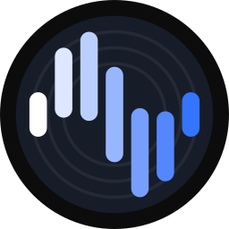
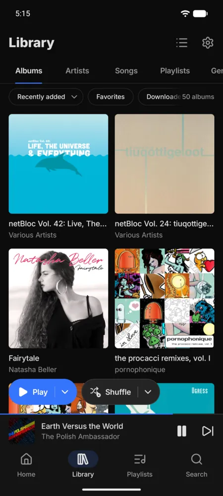

<div align="center">



# Segue

**A fast, minimalist Android client for [Navidrome](https://www.navidrome.org/).**

[](https://github.com/QuantumFF/segue/actions/workflows/ci.yml)
[](#install)
[](https://opensubsonic.netlify.app/)
[](LICENSE)

[Highlights](#highlights) · [Features](#features) · [Install](#install) · [Building](#building) · [Architecture](#architecture)

</div>

Segue is built on the Subsonic API with OpenSubsonic extensions. It aims for a rich feature set, fast
performance, and good battery life. The look comes from [Feishin](https://github.com/jeffvli/feishin)
and the ergonomics from [Symfonium](https://symfonium.app/).

<p align="center">
  
  
  
  
</p>
<p align="center">
  
  
  
  
</p>

## Highlights

### Server queue sync

Your queue follows you between devices. Segue saves it to Navidrome when something changes: track
change, queue edit, pause, seek, or leaving the app. It never polls.

- When you open Segue after listening elsewhere, a *Continue from &lt;device&gt;* bar offers to pick
  up where you left off. Turn on *Continue automatically* and Segue takes the queue over itself, with Undo.
- It uses OpenSubsonic's index-based queue when the server supports it.
- Conflict detection uses the server's own timestamps, so a skewed phone clock doesn't matter.

### Album shuffle

Shuffling happens when music is queued, never to a running queue.

- *Play albums* and *Shuffle albums* sit above the mini player in the Library's Albums view. They
  queue the albums you see, in that order or shuffled, each album whole and in track order.
- Tap to play now, or long-press to play next or add to your queue.
- Every album goes into the queue at once, however big the library.
- *Shuffle albums* also works for an artist, a genre, or a playlist.

## Features

| Area | What you get |
| --- | --- |
| **Playback** | Gapless playback, ReplayGain (track/album, −18 or −23 LUFS normalisation, optional boost for quiet tracks), per-network streaming quality, sleep timer (time, end of track, end of album), instant mix, related songs |
| **Offline** | Pin albums, playlists or artists. Wi-Fi/charging constraints, a storage limit, and offline mode. Plays made offline are scrobbled later |
| **Library** | Multi-select albums, artists or songs to play, queue, favorite or download them together. Favorites, ratings, playlist create/edit/reorder, synced lyrics (OpenSubsonic), scrobbling through Navidrome |
| **Beyond the phone** | Android Auto (browse, voice search), home-screen widgets, and a tablet layout |
| **Themes** | Dark, true-black (AMOLED) and light, with a fixed, Material You, or album-art accent |

## Performance and battery

- Room is the single source of truth. Screens render from local data and refresh in the background.
- Audio offload while the screen is off, burst prefetch of the next track, and no timer polling.
  The foreground service runs only while playing.
- Baseline Profiles and R8 full mode.

See [docs/PERFORMANCE.md](docs/PERFORMANCE.md) for startup and jank measurements, the battery audit,
and how to re-run the benchmarks.

## Install

Debug APKs are attached to every [CI run](https://github.com/QuantumFF/segue/actions). Signed
releases are published under [Releases](https://github.com/QuantumFF/segue/releases) when a
`v*` tag is pushed.

## Releasing

The tag is the version; nothing in the repository needs bumping. Either push a tag, or let the
release workflow tag main's head:

```sh
git tag v1.2.3 && git push origin v1.2.3
gh workflow run release.yml -f version=1.2.3
```

Versions are `1.2.3`, or `1.2.3-alpha.N`, `-beta.N` or `-rc.N` for pre-releases. Both `versionName`
and `versionCode` come from the tag (`build-logic/.../SegueVersion.kt`), and every pre-release gets
a lower `versionCode` than its final release. Local builds report `0.0.0-dev`.

> [!TIP]
> No server yet? Try the public Navidrome demo: `https://demo.navidrome.org`, user `demo`,
> password `demo`.

## Building

Requirements: JDK 21 for Gradle, and an Android SDK with platform 37.

```sh
export JAVA_HOME=/path/to/jdk-21
echo "sdk.dir=$HOME/Android/Sdk" > local.properties
./gradlew assembleDebug                 # debug APK
./gradlew testDebugUnitTest             # unit tests
./gradlew spotlessApply                 # format (ktlint + Compose rules)
./gradlew lintDebug                     # Android lint
./gradlew assembleRelease               # R8 release; signed by SEGUE_* env vars, else the debug key
```

> [!NOTE]
> Release signing reads `SEGUE_KEYSTORE_BASE64`, `SEGUE_KEYSTORE_PASSWORD`, `SEGUE_KEY_ALIAS`
> and `SEGUE_KEY_PASSWORD`. CI reads these from repository secrets.

## Architecture

Kotlin, Jetpack Compose and Material 3. Media3 (ExoPlayer and `MediaLibraryService`) plays, runs
the media session and serves Android Auto. Room holds the library, OkHttp, Retrofit and
kotlinx.serialization talk to the server, and Coil 3 loads cover art at the size it is drawn. Hilt,
DataStore, WorkManager (downloads and library sync) and Paging 3 do the rest.

[docs/DESIGN.md](docs/DESIGN.md) is the UI spec, and [docs/adr/](docs/adr/) records the decisions
behind the architecture.

<details>
<summary>Modules</summary>

| Module | Purpose |
| --- | --- |
| `app` | Entry point, navigation host, Hilt application, image loading |
| `core:model` | Plain Kotlin domain models |
| `core:common` | Coroutine dispatchers and app scope |
| `core:network` | Subsonic/OpenSubsonic client, token auth, capability detection |
| `core:database` | Room entities, DAOs, FTS search, migrations |
| `core:data` | Repositories, incremental library sync, downloads |
| `core:datastore` | Settings and Keystore-encrypted server accounts |
| `core:designsystem` | Theme, tokens, Inter + Lucide, shared components |
| `core:playback` | Media3 `MediaLibraryService`, album plays, queue sync, scrobbling, Android Auto |
| `core:testing` | Shared test utilities |
| `feature:*` | Screens: home, library, album, artist, playlist, search, nowplaying, queue, downloads, settings, login, widget |
| `baselineprofile` | Baseline Profile generator and startup/scroll Macrobenchmarks |

</details>

## License

Segue is free software, licensed under the GNU General Public License v3.0 or later. See
[LICENSE](LICENSE). It bundles [Inter](https://rsms.me/inter/) (SIL OFL 1.1) and
[Lucide](https://lucide.dev/) icons (ISC). Their licenses are in [`third_party/`](third_party/).
