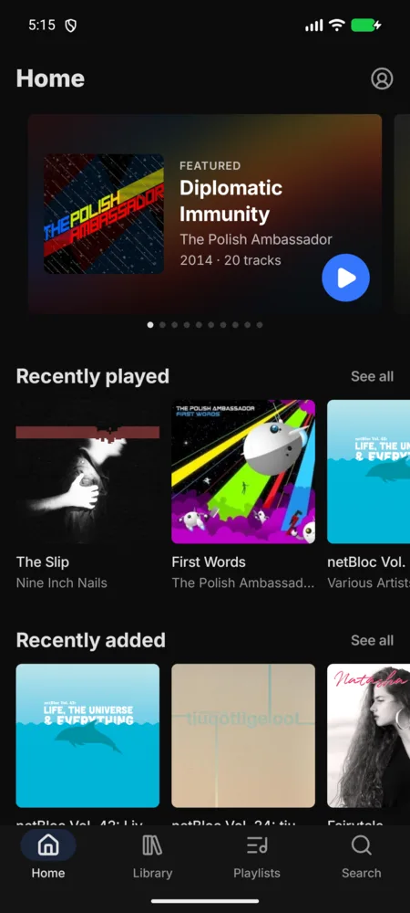
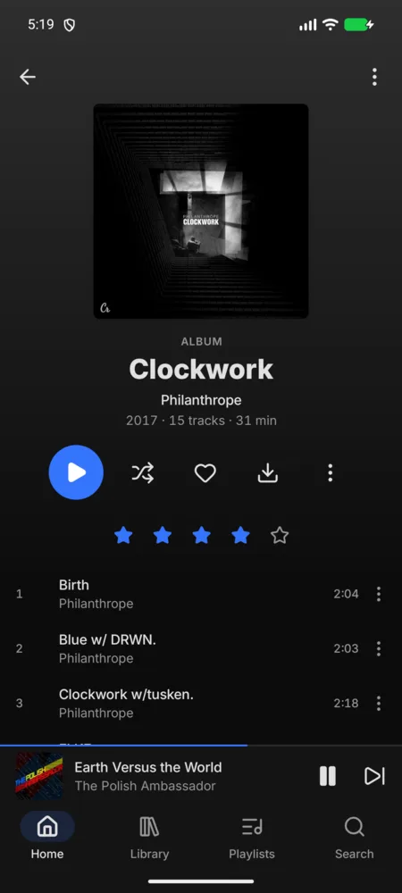
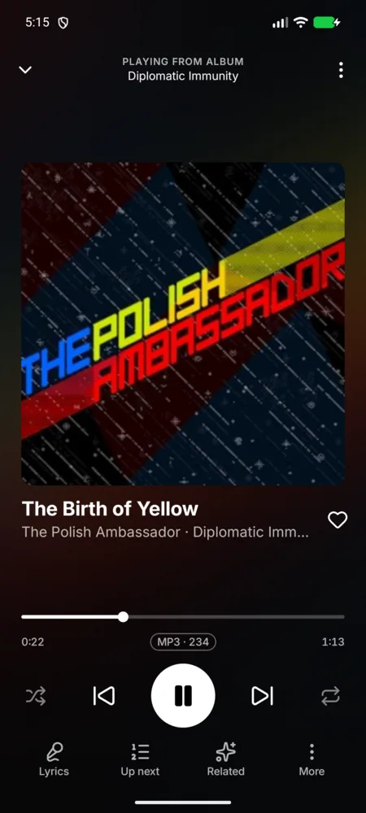
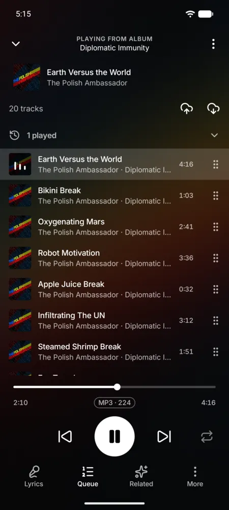
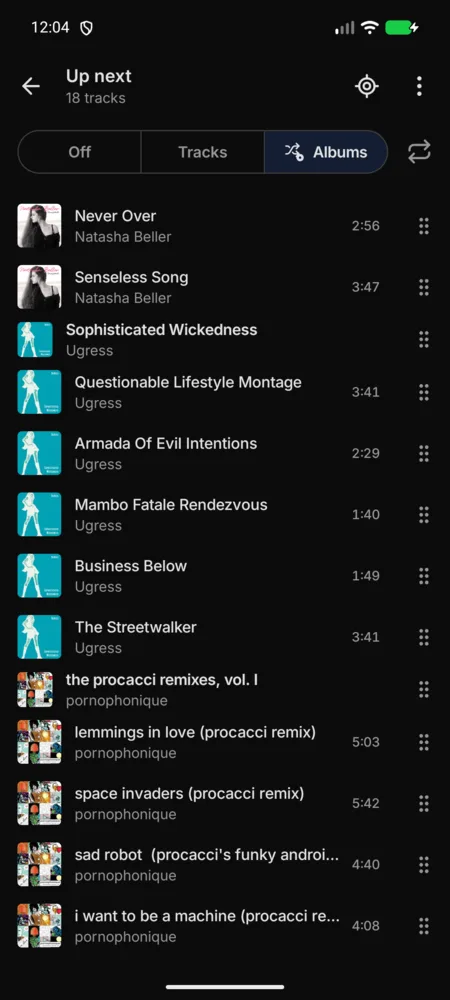
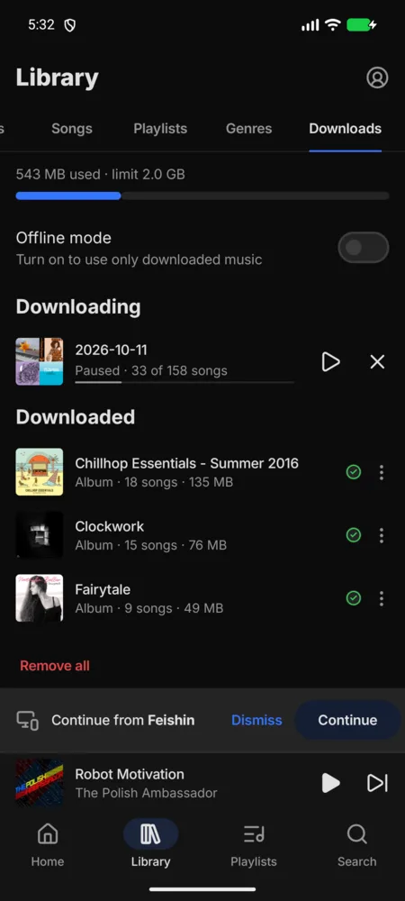
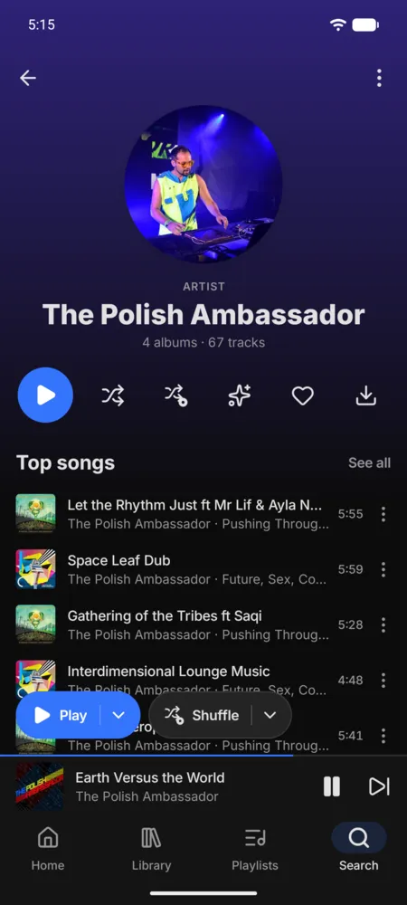
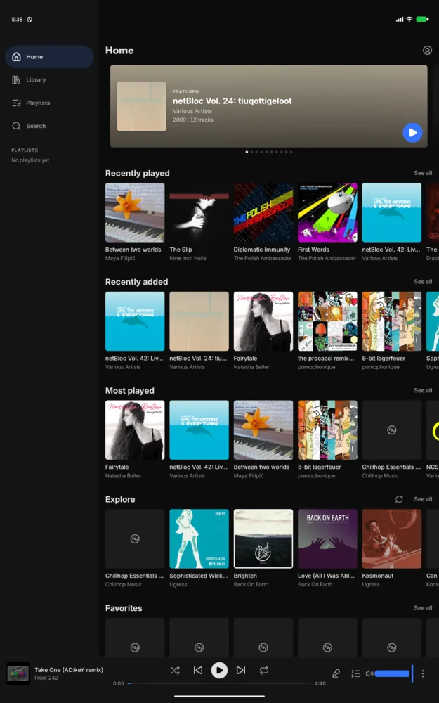

# Segue

A modern, minimalist Android client for [Navidrome](https://www.navidrome.org/). It's built on the
Subsonic API with OpenSubsonic extensions, and aims for a rich feature set, fast performance, and
good battery life. The design is a Feishin-leaning hybrid of [Feishin](https://github.com/jeffvli/feishin)
and Symfonium.

<p>
  
  
  
  
</p>
<p>
  
  
  
  
</p>

## Highlights

- **Server queue sync.** Segue saves your play queue to Navidrome when something changes: track
  change, queue edit, pause, seek, or leaving the app. It never polls. When you open Segue after
  listening elsewhere, a *Continue from &lt;device&gt;* bar offers to pick up where you left off, or
  Segue adopts the queue automatically (with Undo) if you turn that on. It uses OpenSubsonic's
  index-based queue when the server supports it. Conflict detection uses the server's own
  timestamps, so a skewed phone clock doesn't matter.
- **Album shuffle.** Shuffling happens when music is queued, never to a running queue. *Play albums*
  and *Shuffle albums* sit above the mini player in the Library's Albums view. They queue the albums
  you see, in that order or shuffled, each album whole and in track order. Tap to play now, or
  long-press to play next or add to your queue. Big libraries are queued a window at a time as you
  listen. *Shuffle albums* is also available for an artist, a genre, or a playlist.

## Features

- Gapless playback, ReplayGain (track/album, with preamp), per-network streaming quality
- Offline downloads: pin albums, playlists or artists. Wi-Fi/charging constraints, a storage limit,
  and offline mode
- Synced lyrics (OpenSubsonic), sleep timer (time, end of track, end of album), instant mix, related songs
- Scrobbling through Navidrome. Plays made offline are queued and sent later
- Favorites, ratings, and playlist create/edit/reorder
- Android Auto (browse, voice search), home-screen widgets, and a tablet layout
- Dark, true-black (AMOLED) and light themes, with a fixed, Material You, or album-art accent

## Performance and battery

- Room is the single source of truth. Screens render from local data and refresh in the background.
- Audio offload while the screen is off, burst prefetch of the next track, and no timer polling.
  The foreground service runs only while playing.
- Baseline Profiles and R8 full mode.

See [docs/PERFORMANCE.md](docs/PERFORMANCE.md) for startup and jank measurements, the battery audit,
and how to re-run the benchmarks.

## Install

Debug APKs are attached to every [CI run](https://github.com/QuantumFF/segue/actions). Signed
releases are published under [Releases](https://github.com/QuantumFF/segue/releases) when a
`v*` tag is pushed.

To try it without your own server, use the public Navidrome demo:
`https://demo.navidrome.org`, user `demo`, password `demo`.

## Building

Requirements: JDK 21 for Gradle, and an Android SDK with platform 37.

```sh
export JAVA_HOME=/path/to/jdk-21
echo "sdk.dir=$HOME/Android/Sdk" > local.properties
./gradlew assembleDebug                 # debug APK
./gradlew testDebugUnitTest             # unit tests
./gradlew spotlessApply                 # format (ktlint + Compose rules)
./gradlew lintDebug                     # Android lint
./gradlew assembleRelease               # R8 release; signed by SEGUE_* env vars, else the debug key
```

Release signing reads `SEGUE_KEYSTORE_BASE64`, `SEGUE_KEYSTORE_PASSWORD`, `SEGUE_KEY_ALIAS`
and `SEGUE_KEY_PASSWORD`. CI reads these from repository secrets.

## Architecture

See [docs/PLAN.md](docs/PLAN.md) for the architecture and [docs/DESIGN.md](docs/DESIGN.md) for the UI spec.

| Module | Purpose |
| --- | --- |
| `app` | Entry point, navigation host, Hilt application, image loading |
| `core:model` | Plain Kotlin domain models |
| `core:common` | Coroutine dispatchers and app scope |
| `core:network` | Subsonic/OpenSubsonic client, token auth, capability detection |
| `core:database` | Room entities, DAOs, FTS search, migrations |
| `core:data` | Repositories, incremental library sync, downloads |
| `core:datastore` | Settings and Keystore-encrypted server accounts |
| `core:designsystem` | Theme, tokens, Inter + Lucide, shared components |
| `core:playback` | Media3 `MediaLibraryService`, album feeds, queue sync, scrobbling, Android Auto |
| `core:testing` | Shared test utilities |
| `feature:*` | Screens: home, library, album, artist, playlist, search, nowplaying, queue, downloads, settings, login, widget |
| `baselineprofile` | Baseline Profile generator and startup/scroll Macrobenchmarks |

## License

Segue is free software, licensed under the GNU General Public License v3.0 or later. See
[LICENSE](LICENSE). It bundles [Inter](https://rsms.me/inter/) (SIL OFL 1.1) and
[Lucide](https://lucide.dev/) icons (ISC). Their licenses are in [`third_party/`](third_party/).
